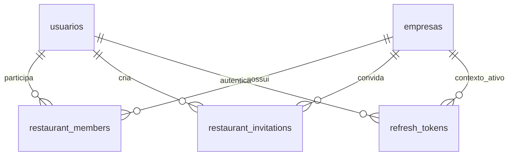

# Contas, restaurantes e equipe

## Modelo de domínio

`usuarios` representa a identidade: nome, e-mail único normalizado e hash da senha. `empresas` representa o restaurante. `restaurant_members` é a associação entre ambos e contém o papel `owner` ou `employee`. Uma identidade pode participar de vários restaurantes e ter papéis diferentes em cada um.

O papel é sempre obtido do vínculo no banco. Os campos antigos `usuarios.papel` e `usuarios.empresa_id` são mantidos para compatibilidade e migração, mas não são a fonte de autorização. Uma futura migração poderá removê-los quando os consumidores antigos forem descontinuados.

## Fluxos

1. **Dono:** cadastro público cria restaurante, usuário e vínculo `owner` em uma transação.
2. **Novo funcionário:** o dono gera um convite para um e-mail. O funcionário abre o link e cria sua própria conta; a mesma transação cria a identidade, consome o convite e registra o vínculo `employee`. Nenhum restaurante novo é criado.
3. **Funcionário com conta:** entra com o e-mail convidado e aceita o convite. A sessão passa a usar o restaurante do convite. Os vínculos anteriores permanecem intactos.
4. **Mais de um restaurante:** a troca de contexto valida o vínculo do usuário no servidor e muda apenas a sessão corrente. Cada sessão mantém seu restaurante ativo independentemente das demais.

Convites são compartilhados manualmente por link. O sistema não envia e-mails. O dono pode revogar um convite ainda não utilizado. Um novo convite para o mesmo e-mail e restaurante revoga o anterior. O token tem 256 bits aleatórios, apenas o SHA-256 é persistido, tem validade de 7 dias e só pode ser consumido pelo e-mail indicado. A aceitação é atômica e não pode elevar o papel de funcionário para dono.

## Camadas

- `src/models`: interfaces TypeScript e funções de repositório com SQL parametrizado (`$1`, `$2`, ...).
- `src/lib/db.ts`: pool de conexões `pg`; `src/lib/postgres.ts`: transações em uma única conexão, com rollback e liberação garantidos.
- `src/lib/auth.ts`: sessão, cookies, identidade atual e proteção de origem.
- `src/lib/restaurants.ts`: vínculos, restaurantes disponíveis e destinos seguros após login.
- `src/lib/invitations.ts`: regras de geração, validação e consumo de convites.
- `src/app/api/v1`: validação de entrada, autenticação, autorização e respostas HTTP.
- Server Components: carregam dados autorizados e passam apenas os dados necessários à interface.
- Client Components: formulários e interações, sem assumir autorização baseada em estado local.

## Fronteira de autorização

Uma sessão válida não é autorização para todos os restaurantes. Toda operação deve obter o usuário no servidor, exigir um vínculo no restaurante ativo e restringir a consulta por esse `empresaId`. Administração de convites exige `role === 'owner'`. Os endpoints ignoram papéis e restaurantes fornecidos pelo cliente quando criam um vínculo por convite.

Funcionários veem o próprio acesso e podem aceitar seus convites. Apenas donos carregam a lista de nomes/e-mails da equipe e os convites pendentes no painel.

## Gastos e central financeira

Os gastos são persistidos em `expenses`, sempre vinculados ao restaurante e ao autor da sessão. Valores são inteiros em centavos e datas de gasto são datas de calendário, sem conversão de fuso. Categoria, pagamento e situação usam valores validados. Totais, distribuição por categoria, série diária e comparação com o período anterior são calculados no servidor para todos os registros filtrados, independentemente da paginação.

Donos e funcionários podem criar gastos e consultar a central do restaurante ativo. Funcionários só alteram os próprios registros; donos podem alterar todos. Toda consulta e mutação inclui `empresaId` da sessão. A sessão e a origem são validadas novamente nos endpoints.

Cada criação recebe um identificador de envio único por restaurante para evitar duplicidade em uma nova tentativa de rede. Edições e exclusões exigem a versão atual, com bloqueio de linha (`SELECT ... FOR UPDATE`) no PostgreSQL. Exclusões são lógicas e não entram nos gráficos. `expense_audit` mantém autor, ação e valores anteriores/posteriores de cada operação; não há endpoint público para apagar esse histórico.

O `schema.sql` define as tabelas e os índices, com valores em `BIGINT`, datas em `DATE` e auditoria em `JSONB`. A interface tem Visão geral, Lançamentos e Equipe, com um formulário compartilhado para criação/edição, gráficos SVG e exportação CSV que neutraliza fórmulas em texto fornecido por usuários.

## Migração e operação

O sistema usa PostgreSQL e SQL puro por meio de `pg`, sem ORM. Configure `DATABASE_URL` e aplique `schema.sql` com `npm run db:migrate`. O script é idempotente para criação da estrutura; mudanças futuras em tabelas existentes devem ser feitas por migrações SQL explícitas. Ele não converte nem importa o antigo banco SQLite.

Consultas de sessão e equipe usam joins para evitar consultas por registro. Os gráficos consultam um snapshot consistente em transação `REPEATABLE READ READ ONLY`. O repositório converte `BIGINT` e agregações para números apenas depois de verificar o intervalo seguro de JavaScript, e retorna `DATE` como texto de calendário. Sessões e convites continuam guardando apenas hashes de tokens; bcrypt e o formato dos tokens foram preservados.

Criações de gastos usam `ON CONFLICT` e uma chave única por restaurante para tratar reenvios concorrentes. Aceitações de convite bloqueiam a linha do convite, enquanto reenvios são serializados por restaurante/e-mail com um advisory lock transacional. Limites de login usam um UPSERT atômico com `RETURNING`.

Para um futuro ambiente serverless, use a URL de conexão com pooling oferecida pelo provedor e configure TLS conforme a documentação dele. O pool é reutilizado em desenvolvimento; não se encerra o pool a cada requisição. O código não desativa validação de certificados.

## Verificação

Execute `npm run build` antes de `npm test`. Os testes HTTP usam schemas PostgreSQL temporários, com nomes gerados internamente e removidos ao final; não alteram tabelas do schema da aplicação. Configure `TEST_DATABASE_URL` para usar um banco dedicado, ou os testes usarão `DATABASE_URL`. O usuário dos testes precisa de permissão para criar schemas. `npm run lint` e `npm run typecheck` completam as verificações.

## Remoção da equipe e exemplos de teste

Remover um funcionário exclui apenas seu vínculo no restaurante ativo, revoga as sessões que usam esse contexto e os convites pendentes desse restaurante. A identidade e os gastos permanecem, preservando `created_by` e a auditoria. Donos não podem ser removidos por esse endpoint. A operação exige dono, origem válida e uma transação com bloqueio do vínculo.

A coluna `expenses.demo_key` identifica exclusivamente os exemplos; um índice único por restaurante impede duplicatas. O script local `scripts/seed-demo-data.ts` adiciona até 16 gastos de demonstração por mês. Para um histórico completo, execute `node --env-file-if-exists=.env --import tsx scripts/seed-demo-history.ts EMAIL ID_RESTAURANTE AAAA-MM-DD [AAAA-MM-DD]`: ele exige dono, usa uma transação e chaves repetíveis, acrescenta gastos de todas as categorias e preenche apenas quantidades ausentes de faturamento, preservando valores já informados. Registros com faturamento zero recebem quantidades fictícias zero quando estavam vazias. `daily_revenue.demo_key` identifica os dias que contêm exemplos; salvar manualmente o dia remove essa marcação. Exemplos de produtos incluem conteúdo por embalagem. Não há endpoint público `/api/v1/demo-data` nem dependência de `ENABLE_DEMO_DATA`. Os campos de marcação de exemplos e autoria nunca são aceitos do cliente na criação normal de gastos.

`scripts/audit-financial-data.ts EMAIL ID_RESTAURANTE INICIO FIM` compara o banco com painel, séries e planilha, confere a exportação/releitura de todos os campos de gastos e faturamento, verifica vínculos de produtos e a prévia de reimportação sem duplicatas. Também valida as células dos arquivos Excel e o manifesto ZIP. Os arquivos e o relatório JSON ficam em `reports/`, ignorado pelo Git. A autoria de novos registros importados sempre pertence ao usuário que confirmou a importação; IDs de produtos e categorias são resolvidos no restaurante de destino.

Para a demonstração detalhada da Cozinha Boa, `scripts/seed-restaurant-demo.ts EMAIL ID_RESTAURANTE INICIO FIM` gera compras diárias com produtos nas categorias Mercado, Hortifruti e Açougue; despesas de Moto 1, Moto 2 e Nando nos dias de funcionamento; reforço de Extra Pessoas nos finais de semana; compras de Queijo, Alho/gás e Material e contas mensais em Fixos. Reutiliza os IDs das categorias existentes. Segundas-feiras têm faturamento e quantidades zero, podendo conter compras de abastecimento e contas. Dias futuros recebem observação de simulação e situação a pagar. O script corrige os faturamentos marcados como demonstração, preserva os demais em dias abertos e faz backup do faturamento anterior em `reports/`. Gastos excluídos não são restaurados; chaves determinísticas evitam duplicatas. `scripts/verify-financial-roundtrip.ts PASTA_AUDITORIA` reimporta os arquivos em um schema temporário, compara todos os campos financeiros e remove o schema ao final.

A listagem de gastos e os arquivos consultados a partir da interface enviam `expectedEmpresaId`; se a sessão tiver sido trocada para outro restaurante em outra aba, o servidor responde 409. Formulários e ações destrutivas também vinculam o contexto. A fonte de autorização continua sendo a sessão e o vínculo no banco: o identificador enviado pela interface não concede acesso.

Criação e revogação de convites revalidam o papel de dono na transação e bloqueiam o vínculo com `FOR SHARE`. A revogação usa a mesma conexão da autorização. A importação de produtos carrega o catálogo uma vez por arquivo, mantendo índices de nomes e IDs em memória somente durante a transação.

A série financeira é agrupada no servidor: diária até 90 dias, mensal até cinco anos e anual para períodos maiores. Totais, dia de pico e dias com gastos são calculados sobre os registros completos, preservando os valores em centavos e os dias sem gasto. Não há limite de duração do período dentro das datas válidas do sistema. O gráfico de categorias usa segmentos SVG interativos e uma legenda selecionável, com operação por toque, mouse e teclado.

## Arquivos de lançamentos e PDF

A exportação CSV usa UTF-8 com BOM, ponto e vírgula e datas com prefixo textual para evitar conversão automática para datas com largura insuficiente na planilha. Textos que poderiam ser interpretados como fórmulas são neutralizados. A alternativa XLSX usa células tipadas e larguras explícitas.

A importação CSV faz validação no servidor com `csv-parse`, prévia e confirmação separadas. A confirmação revalida o arquivo, bloqueia o vínculo do ator, usa SQL parametrizado e realiza gravação e auditoria em uma única transação. Limites por arquivo: 2 MB e 2.000 registros. IDs existentes são consultados somente no restaurante da sessão. IDs de envio determinísticos e um bloqueio transacional por restaurante impedem duplicatas em reenvios concorrentes. A autoria de novos gastos vem exclusivamente da sessão.

Na reimportação, somente registros ativos são tratados como repetidos. Registros excluídos identificados pelo ID ou pela chave de importação podem ser restaurados pelo dono ou pelo autor. A restauração usa os valores do CSV, mantém ID, autoria e marcação de exemplo, incrementa a versão e registra antes/depois na auditoria. Novas inclusões e restaurações pertencem à mesma transação. A prévia informa erros de permissão e a confirmação verifica novamente o papel no banco. Assim, exportar exemplos, limpar e reimportar o arquivo restaura esses exemplos sem duplicá-los.

A exportação XLSX utiliza um intervalo de células com formatação explícita, cabeçalho congelado e um único autofiltro, sem tabelas estruturadas sobrepostas. Datas são valores de calendário à meia-noite UTC e valores monetários permanecem numéricos. Os testes verificam o pacote ZIP/XML e a leitura dos valores; a abertura no aplicativo Microsoft Excel não é coberta pelos testes automatizados.

O relatório PDF é gerado no servidor com PDFKit, gráficos vetoriais e fontes Noto Sans incluídas no projeto sob licença OFL. O arquivo usa o mesmo resumo e os mesmos filtros do painel, sem capturar conteúdo arbitrário de navegador ou fazer requisições externas. As fontes são incluídas no rastreamento de arquivos do Next para implantação.
