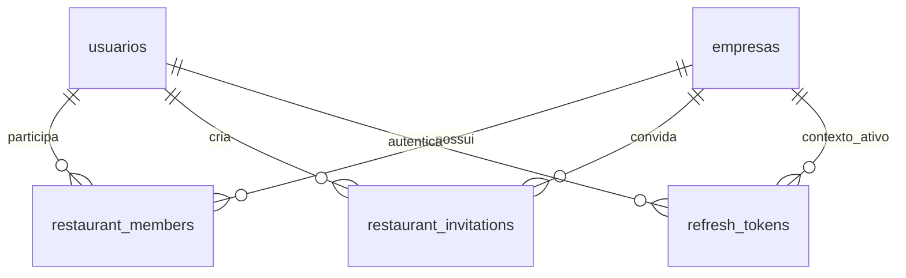

# Contas, restaurantes e equipe

## Modelo de domínio

`usuarios` representa a identidade: nome, e-mail único normalizado e hash da senha. `empresas` representa o restaurante. `restaurant_members` é a associação entre ambos e contém o papel `owner` ou `employee`. Uma identidade pode participar de vários restaurantes e ter papéis diferentes em cada um.

O papel é sempre obtido do vínculo no banco. Os campos antigos `usuarios.papel` e `usuarios.empresa_id` são mantidos para compatibilidade e migração, mas não são a fonte de autorização. Uma futura migração poderá removê-los quando os consumidores antigos forem descontinuados.

## Fluxos

1. **Dono:** cadastro público cria restaurante, usuário e vínculo `owner` em uma transação.
2. **Novo funcionário:** o dono gera um convite para um e-mail. O funcionário abre o link e cria sua própria conta; a mesma transação cria a identidade, consome o convite e registra o vínculo `employee`. Nenhum restaurante novo é criado.
3. **Funcionário com conta:** entra com o e-mail convidado e aceita o convite. A sessão passa a usar o restaurante do convite. Os vínculos anteriores permanecem intactos.
4. **Mais de um restaurante:** a troca de contexto valida o vínculo do usuário no servidor e muda apenas a sessão corrente. Cada sessão mantém seu restaurante ativo independentemente das demais.

Convites são compartilhados manualmente por link. O sistema não envia e-mails. O dono pode revogar um convite ainda não utilizado. Um novo convite para o mesmo e-mail e restaurante revoga o anterior. O token tem 256 bits aleatórios, apenas o SHA-256 é persistido, tem validade de 7 dias e só pode ser consumido pelo e-mail indicado. A aceitação é atômica e não pode elevar o papel de funcionário para dono.

## Camadas

- `src/models`: interfaces TypeScript e funções de repositório com SQL parametrizado (`$1`, `$2`, ...).
- `src/lib/db.ts`: pool de conexões `pg`; `src/lib/postgres.ts`: transações em uma única conexão, com rollback e liberação garantidos.
- `src/lib/auth.ts`: sessão, cookies, identidade atual e proteção de origem.
- `src/lib/restaurants.ts`: vínculos, restaurantes disponíveis e destinos seguros após login.
- `src/lib/invitations.ts`: regras de geração, validação e consumo de convites.
- `src/app/api/v1`: validação de entrada, autenticação, autorização e respostas HTTP.
- Server Components: carregam dados autorizados e passam apenas os dados necessários à interface.
- Client Components: formulários e interações, sem assumir autorização baseada em estado local.

## Fronteira de autorização

Uma sessão válida não é autorização para todos os restaurantes. Toda operação deve obter o usuário no servidor, exigir um vínculo no restaurante ativo e restringir a consulta por esse `empresaId`. Administração de convites exige `role === 'owner'`. Os endpoints ignoram papéis e restaurantes fornecidos pelo cliente quando criam um vínculo por convite.

Funcionários veem o próprio acesso e podem aceitar seus convites. Apenas donos carregam a lista de nomes/e-mails da equipe e os convites pendentes no painel.

## Gastos e central financeira

Os gastos são persistidos em `expenses`, sempre vinculados ao restaurante e ao autor da sessão. Valores são inteiros em centavos e datas de gasto são datas de calendário, sem conversão de fuso. Categoria, pagamento e situação usam valores validados. Totais, distribuição por categoria, série diária e comparação com o período anterior são calculados no servidor para todos os registros filtrados, independentemente da paginação.

Donos e funcionários podem criar gastos e consultar a central do restaurante ativo. Funcionários só alteram os próprios registros; donos podem alterar todos. Toda consulta e mutação inclui `empresaId` da sessão. A sessão e a origem são validadas novamente nos endpoints.

Cada criação recebe um identificador de envio único por restaurante para evitar duplicidade em uma nova tentativa de rede. Edições e exclusões exigem a versão atual, com bloqueio de linha (`SELECT ... FOR UPDATE`) no PostgreSQL. Exclusões são lógicas e não entram nos gráficos. `expense_audit` mantém autor, ação e valores anteriores/posteriores de cada operação; não há endpoint público para apagar esse histórico.

O `schema.sql` define as tabelas e os índices, com valores em `BIGINT`, datas em `DATE` e auditoria em `JSONB`. A interface tem Visão geral, Lançamentos e Equipe, com um formulário compartilhado para criação/edição, gráficos SVG e exportação CSV que neutraliza fórmulas em texto fornecido por usuários.

## Migração e operação

O sistema usa PostgreSQL e SQL puro por meio de `pg`, sem ORM. Configure `DATABASE_URL` e aplique `schema.sql` com `npm run db:migrate`. O script é idempotente para criação da estrutura; mudanças futuras em tabelas existentes devem ser feitas por migrações SQL explícitas. Ele não converte nem importa o antigo banco SQLite.

Consultas de sessão e equipe usam joins para evitar consultas por registro. Os gráficos consultam um snapshot consistente em transação `REPEATABLE READ READ ONLY`. O repositório converte `BIGINT` e agregações para números apenas depois de verificar o intervalo seguro de JavaScript, e retorna `DATE` como texto de calendário. Sessões e convites continuam guardando apenas hashes de tokens; bcrypt e o formato dos tokens foram preservados.

Criações de gastos usam `ON CONFLICT` e uma chave única por restaurante para tratar reenvios concorrentes. Aceitações de convite bloqueiam a linha do convite, enquanto reenvios são serializados por restaurante/e-mail com um advisory lock transacional. Limites de login usam um UPSERT atômico com `RETURNING`.

Para um futuro ambiente serverless, use a URL de conexão com pooling oferecida pelo provedor e configure TLS conforme a documentação dele. O pool é reutilizado em desenvolvimento; não se encerra o pool a cada requisição. O código não desativa validação de certificados.

## Verificação

Execute `npm run build` antes de `npm test`. Os testes HTTP usam schemas PostgreSQL temporários, com nomes gerados internamente e removidos ao final; não alteram tabelas do schema da aplicação. Configure `TEST_DATABASE_URL` para usar um banco dedicado, ou os testes usarão `DATABASE_URL`. O usuário dos testes precisa de permissão para criar schemas. `npm run lint` e `npm run typecheck` completam as verificações.

## Remoção da equipe e exemplos de teste

Remover um funcionário exclui apenas seu vínculo no restaurante ativo, revoga as sessões que usam esse contexto e os convites pendentes desse restaurante. A identidade e os gastos permanecem, preservando `created_by` e a auditoria. Donos não podem ser removidos por esse endpoint. A operação exige dono, origem válida e uma transação com bloqueio do vínculo.

A coluna `expenses.demo_key` identifica exclusivamente os exemplos; um índice único por restaurante impede duplicatas. O endpoint de demonstração exige `ENABLE_DEMO_DATA=true` e papel de dono. Restaurar gera 18 registros por mês desde janeiro de 2025 até hoje, reaproveitando as mesmas identidades e preservando a autoria original; limpar realiza exclusão lógica somente dos exemplos. Ambas as operações têm auditoria e são serializadas por restaurante. Os campos de marcação de exemplos e autoria nunca são aceitos do cliente na criação normal de gastos.

O filtro `year` é validado no servidor e convertido em datas: anos anteriores usam janeiro a dezembro; o ano atual termina na data de hoje em São Paulo. A lista de anos vem dos gastos ativos do restaurante, incluindo sempre o ano atual. Exemplos usam chaves por mês (`v2-AAAA-MM-N`), permitindo acrescentar meses sem mover registros antigos. Restaurar aposenta por exclusão lógica os exemplos da versão anterior, preservando gastos reais e auditoria.

A série financeira permanece diária na API; o gráfico agrupa por mês ao exibir mais de 90 dias, preservando os valores em centavos. O gráfico de categorias usa segmentos SVG interativos e uma legenda selecionável, com operação por toque, mouse e teclado.
