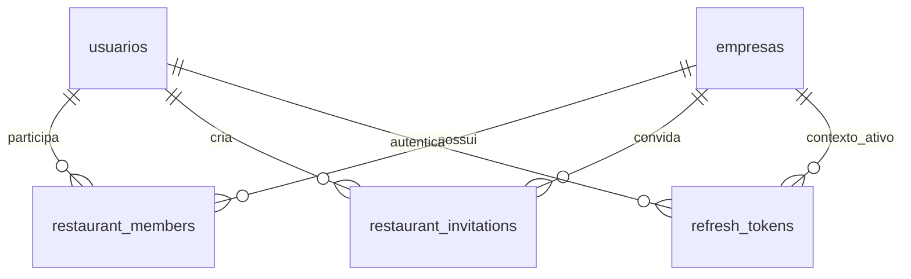

# Contas, restaurantes e equipe

## Modelo de domínio

`usuarios` representa a identidade: nome, e-mail único normalizado e hash da senha. `empresas` representa o restaurante. `restaurant_members` é a associação entre ambos e contém o papel `owner` ou `employee`. Uma identidade pode participar de vários restaurantes e ter papéis diferentes em cada um.

O papel é sempre obtido do vínculo no banco. Os campos antigos `usuarios.papel` e `usuarios.empresaId` são mantidos para compatibilidade e migração, mas não são a fonte de autorização. Uma futura migração poderá removê-los quando os consumidores antigos forem descontinuados.

## Fluxos

1. **Dono:** cadastro público cria restaurante, usuário e vínculo `owner` em uma transação.
2. **Novo funcionário:** o dono gera um convite para um e-mail. O funcionário abre o link e cria sua própria conta; a mesma transação cria a identidade, consome o convite e registra o vínculo `employee`. Nenhum restaurante novo é criado.
3. **Funcionário com conta:** entra com o e-mail convidado e aceita o convite. A sessão passa a usar o restaurante do convite. Os vínculos anteriores permanecem intactos.
4. **Mais de um restaurante:** a troca de contexto valida o vínculo do usuário no servidor e muda apenas a sessão corrente. Cada sessão mantém seu restaurante ativo independentemente das demais.

Convites são compartilhados manualmente por link. O sistema não envia e-mails. O dono pode revogar um convite ainda não utilizado. Um novo convite para o mesmo e-mail e restaurante revoga o anterior. O token tem 256 bits aleatórios, apenas o SHA-256 é persistido, tem validade de 7 dias e só pode ser consumido pelo e-mail indicado. A aceitação é atômica e não pode elevar o papel de funcionário para dono.

## Camadas

- `src/models`: modelos de persistência, com constraints e índices aplicados por migrações.
- `src/lib/auth.ts`: sessão, cookies, identidade atual e proteção de origem.
- `src/lib/restaurants.ts`: vínculos, restaurantes disponíveis e destinos seguros após login.
- `src/lib/invitations.ts`: regras de geração, validação e consumo de convites.
- `src/app/api/v1`: validação de entrada, autenticação, autorização e respostas HTTP.
- Server Components: carregam dados autorizados e passam apenas os dados necessários à interface.
- Client Components: formulários e interações, sem assumir autorização baseada em estado local.

## Fronteira de autorização

Uma sessão válida não é autorização para todos os restaurantes. Toda operação deve obter o usuário no servidor, exigir um vínculo no restaurante ativo e restringir a consulta por esse `empresaId`. Administração de convites exige `role === 'owner'`. Os endpoints ignoram papéis e restaurantes fornecidos pelo cliente quando criam um vínculo por convite.

Funcionários veem o próprio acesso e podem aceitar seus convites. Apenas donos carregam a lista de nomes/e-mails da equipe e os convites pendentes no painel.

## Evolução financeira

Nenhum lançamento de gastos foi implementado nesta etapa. A futura entidade de gasto deverá conter `empresaId`, `createdBy`, categoria, valor em centavos e datas de criação/competência. Tanto donos quanto funcionários poderão registrar gastos de seu restaurante; permissões para alteração, aprovação e exclusão devem ser definidas antes de implementar essas operações. Os registros não devem confiar em `empresaId` ou autor enviados pelo navegador.

## Migração e operação

A migração `002-restaurant-memberships` cria vínculos a partir dos usuários existentes, converte `admin` em `owner` e os demais em `employee`, e preserva o contexto das sessões existentes. O comando de migração cria backup antes de alterar o banco.

SQLite continua apropriado para o estágio atual, em uma instância com disco persistente. O domínio de vínculos é independente do banco, mas migrar a persistência e os limites de tentativas para PostgreSQL exige adaptadores e migrações próprios. Não é suportada uma implantação com várias instâncias usando cópias independentes do SQLite.
